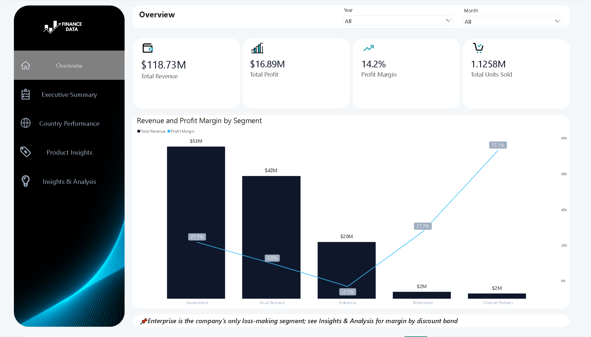
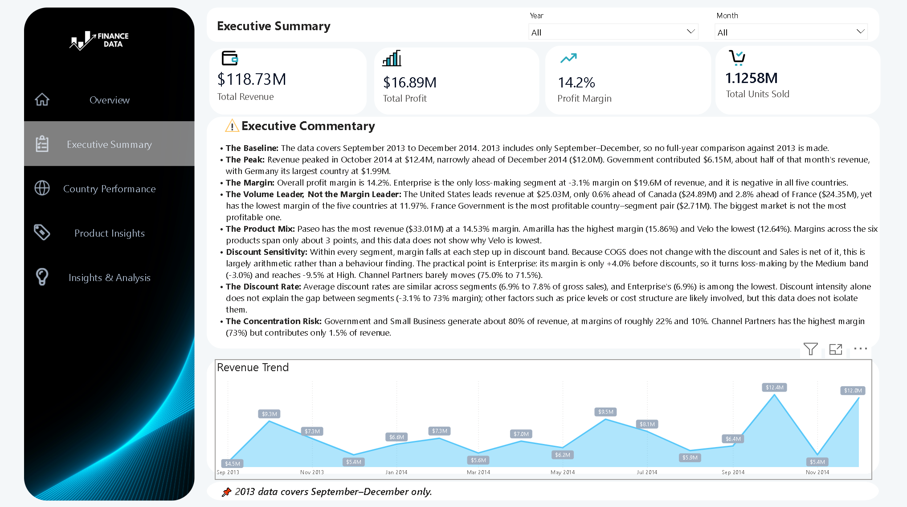
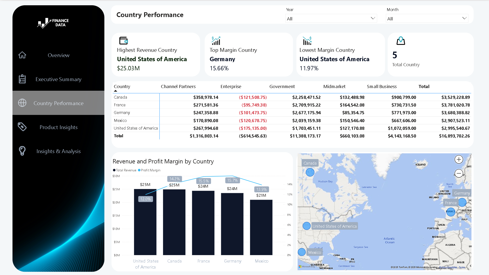
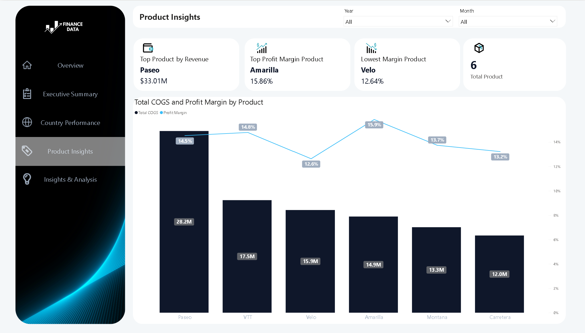
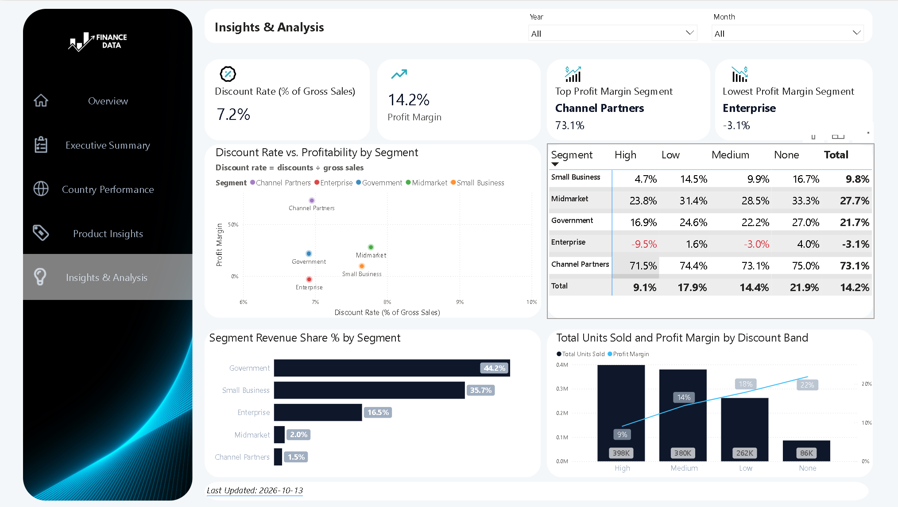

# Microsoft Financial Sample: SQL, pandas and Power BI audit

Analysis of Microsoft's Financial Sample dataset (700 rows, 5 segments, 5 countries, 6 products, September 2013 to December 2014). Built with MySQL and Power BI, then re-verified independently in pandas. Headline totals reconcile across all three tools.

## Dashboard

## Key findings

- **Totals:** $118.73M revenue, $16.89M profit, 14.2% margin.
- **Enterprise is the only loss-making segment:** -3.1% margin on $19.6M of revenue, negative in all five countries. Its margin is +4.0% with no discount, -3.0% at Medium and -9.5% at High discounts.
- **Concentration:** Government and Small Business generate about 80% of revenue. Channel Partners has the highest margin (73.1%) but only 1.5% of revenue.
- **Volume is not profit:** the United States leads revenue ($25.03M, only 0.6% ahead of Canada) but has the lowest country margin (11.97%). France Government is the most profitable country-segment pair ($2.71M).
- **Products:** Paseo has the most revenue ($33.01M, 14.53% margin). Amarilla has the highest margin (15.86%), Velo the lowest (12.64%). Margins across products span only about 3 points.
- **Timing:** October 2014 was the peak month ($12.4M, about half from Government). Comparing September to December only, revenue rose from $26.4M (2013) to $36.2M (2014), +36.9%; November fell 25.9% and December rose 123.5%.
- **Discounts:** discount rates are similar across segments (6.9% to 7.8% of gross sales, 7.2% overall) while margins range from -3% to 73%, so discount rate alone does not explain the segment gaps. Within a segment, margin falls as the discount band rises, but because COGS does not change with the discount and Sales is net of it, this is largely arithmetic rather than a behavioural finding.

## Audit log: errors found and fixed

1. **Cost chart summed a unit price.** "Total manufacturing cost" added the per-unit Manufacturing Price once per row (for example VTT: 250 x 109 rows = 27,250). It was replaced with COGS ($101.83M total). The corrected ranking differs: Paseo has the largest COGS ($28.2M).
2. **Hardcoded constant.** The price-to-cost ratio used a fixed 350 instead of the Sale Price column in both SQL and DAX. It was corrected, then removed from the dashboard because Manufacturing Price does not reconcile with COGS (see data notes).
3. **Discount rate definition.** The dashboard divided discounts by net Sales (7.8%). It now uses gross sales (7.2%), the standard definition.
4. **Partial year.** 2013 contains only September to December. Pooled month rankings double-counted those months and year-over-year comparisons were not like-for-like. Both were replaced with like-for-like comparisons.
5. **Dashboard takeaways.** Every claim in the written commentary was checked against the data and several were corrected (for example the size of the US revenue lead and the direction of Enterprise's discount effect).

## Data notes

- **Manufacturing Price does not reconcile with COGS.** Implied unit COGS (COGS / Units Sold) ranges from $3 to $260 for every product, and 206 of 700 rows sell below the Manufacturing Price yet show a profit. Cost analysis therefore uses COGS.
- **Discount Band "None"** is stored as text in the Excel file and read as blank by pandas; the script restores it.
- **Rounding:** SQL totals differ from pandas by a few dollars because values were rounded on import. Percentages agree to two decimals.
- **Limitations:** single flat table, so the SQL is aggregation plus one window function (no joins). The dataset is a synthetic Microsoft sample, so findings describe this data, not a real business.
- **Data source:** Microsoft's Financial Sample workbook, available from [Microsoft Learn](https://learn.microsoft.com/en-us/power-bi/create-reports/sample-financial-download). The data belongs to Microsoft and is included here only so the analysis can be reproduced.
## Files

| File | Contents |
|---|---|
| `finance_analysis.sql` | 10 MySQL queries plus like-for-like variants |
| `financial_sample_analysis.py` | pandas re-verification with reconciliation and data-quality checks |
| `output.txt` | saved output of the script |
| `requirements.txt` | pinned dependencies (pandas 3.0.6, openpyxl 3.1.5) |
| `Finance_Dashboard.pbix` | Power BI report |
| `screenshots/` | dashboard pages |

## How to run
1. The workbook `Financial Sample.csv.xlsx` is included in this repo. Keep it in the same folder as the script.
2. Place `Financial Sample.csv.xlsx` (Microsoft's Financial Sample workbook) in the same folder as the script.
3. `pip install -r requirements.txt`
4. `python financial_sample_analysis.py`

Tested with pandas 3.0.6 and openpyxl 3.1.5.
