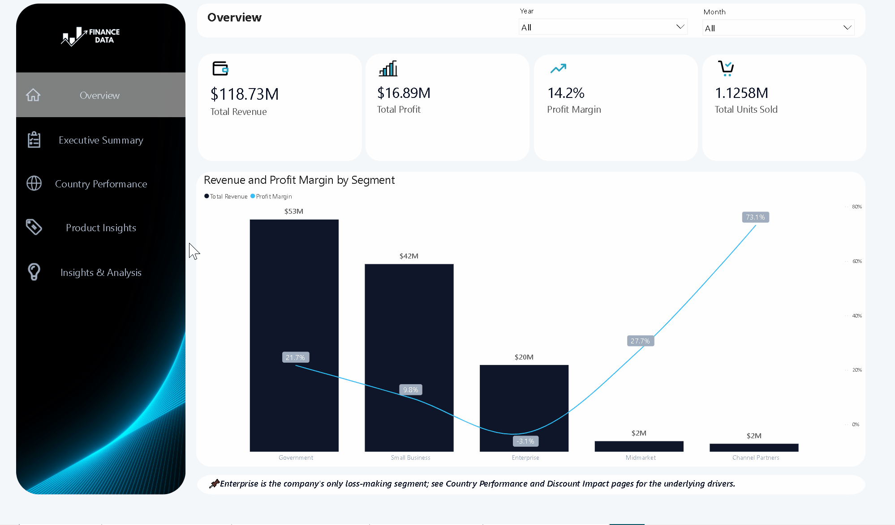

# Microsoft Financial Sample Analytics

An end-to-end data analytics project analyzing the Microsoft Financial Sample dataset using **MySQL** for data analysis and **Power BI** for interactive dashboard visualization.

---

## Project Overview

This project explores global sales performance across 5 countries, 6 products, and 5 customer segments — covering revenue trends, profit margin efficiency, discount impact, and product-level cost analysis.

**Dataset:** Microsoft Financial Sample (700 rows, single flat table)  
**Tools:** MySQL Workbench · Power BI Desktop · Microsoft Excel  
**Scope:** September 2013 – December 2014 (2013 data covers Sep–Dec only)  
**Last Updated:** July 10, 2026

---

## Business Questions

1. What is the total revenue by country and segment?
2. What is the profit and profit margin by country and segment?
3. Which product has the highest profit margin despite high manufacturing cost?
4. How do discount bands affect both units sold and profit margin?
5. Which months consistently generate the highest and lowest revenue?
6. What is the best and least profitable year for the company?
7. Which products have the lowest sale price to manufacturing price ratio?
8. Which country and segment combination drives the most profit?
9. How does discount rate correlate with profit margin across segments?
10. What is the revenue concentration risk across segments?

---

## Key Findings

### Revenue & Profit
- **Total Revenue:** $118.73M | **Total Profit:** $16.89M | **Profit Margin:** 14.2%
- **2014** generated $92.3M vs $26.4M in 2013 — a 349.5% increase (note: 2013 is a partial year of 4 months only; this comparison reflects a partial-year baseline, not true annual growth)
- **October 2014** was the peak month at $12.4M, driven by the Government segment ($6.2M) and Germany ($3.4M)
- **March** is the weakest month at $5.6M total revenue across both years

### Segment Performance
- **Government** dominates revenue at $52.5M (44.2% of total), followed by Small Business at $42.4M (35.7%)
- **Enterprise** is the only loss-making segment at -3.1% margin despite generating $20M in revenue
- **Channel Partners** has the highest profit margin at 73.1% but contributes only 1.5% of total revenue — the business's most efficient segment is also its smallest
- Government and Small Business together represent ~80% of all revenue — heavy concentration risk

### Discount Impact
- **Overall discount rate: 7.8%** across all transactions
- Higher discounts destroy margin across every segment without exception
- Enterprise goes from +4.0% margin with no discount to -9.53% with high discounts — aggressive discounting is the primary driver of Enterprise losses
- Channel Partners is discount-resistant: margin moves only from 75.0% (no discount) to 71.5% (high discount)
- No-discount orders generate 22% margin vs 9% for high-discount orders

### Country Performance
- **United States** leads revenue at $25.03M but holds the lowest profit margin at 11.97%
- **Germany** has the highest profit margin at 15.66%
- **France + Government** is the single most profitable country+segment combination at $2.7M profit
- Enterprise segment is loss-making across all 5 countries — a systemic pricing or cost structure problem, not a regional one
- Margin range across all 5 countries is only 3.7 percentage points (11.97%–15.66%), indicating consistent performance globally

### Product Insights
- **Paseo** is the highest revenue product at $33.01M with a 14.5% margin
- **Amarilla** delivers the strongest profit margin at 15.86% despite being the second most expensive product to manufacture (24,440 total manufacturing cost)
- **VTT** has the highest manufacturing cost (27,250) but lower margin than Amarilla (14.8%) — least efficient high-cost product
- **Velo** is the lowest margin product at 12.64%
- **Amarilla** and **VTT** have the lowest price-to-cost ratios (1.35x and 1.40x) — most vulnerable to cost increases or discount pressure
- **Carretera** has the highest price-to-cost ratio (116.67x) — extremely low manufacturing cost relative to sale price

---

## Dashboard Pages

| Page | Description |
|------|-------------|
| **Overview** | KPI cards (Total Revenue, Profit, Margin, Units Sold), revenue and margin by segment and country |
| **Executive Summary** | Executive commentary with 8 analytical insights, revenue trend Sep 2013–Dec 2014 |
| **Country Performance** | Country KPIs, profit matrix by country+segment (with conditional formatting), revenue and margin combo chart, geographic map |
| **Product Insights** | KPI cards, manufacturing cost vs margin by product, price-to-cost ratio by product |
| **Insights & Analysis** | Discount efficiency vs profitability scatter plot, margin matrix by segment and discount band, segment revenue concentration, units sold and margin by discount band |

---

## SQL Analysis

All 10 business questions were answered using MySQL before building the dashboard. See [`finance_analysis.sql`](finance_analysis.sql) for all queries.

**Techniques used:** `GROUP BY`, `ORDER BY`, `SUM()`, `ROUND()`, `AVG()`, Window Functions (`SUM() OVER()`)

---

## Data Limitations

- **2013 is a partial year** (September–December only). Year-over-year comparisons against 2013 should be interpreted with caution — the 349.5% revenue growth reflects a partial-year baseline, not true annual growth.
- **Single flat table** — no relational joins required; all analysis performed on one table with 700 rows and 16 columns.
- **Sale Price is constant at $350** across all products and transactions — price-to-cost ratios reflect manufacturing cost differences only, not pricing strategy variation.

---

## Repository Structure

```
Microsoft-Financial-Sample-Analytics/
│
├── Finance_Dashboard.pbix          # Power BI dashboard file
├── finance_analysis.sql            # All 10 SQL queries
├── Financial Sample.xlsx           # Source dataset
└── README.md                       # Project documentation
```

---

## Dashboard Preview



---

**Author:** Quratulain Tariq  
[](https://www.linkedin.com/in/quratulain-siddiqui)
[](https://github.com/Quratulain-qurat97)
